# Бот онлайн-записи к специалисту

Telegram-бот, через который клиенты сами записываются к частному специалисту: мастеру маникюра, барберу, массажисту, репетитору и т.д. Специалист управляет услугами, расписанием и записями прямо в Telegram — без сайтов и админок.

Бот универсальный: сфера задаётся только текстами и списком услуг, поэтому под нового заказчика он настраивается за минуты.

**Стек:** Python 3.11+, aiogram 3, SQLite (aiosqlite), pydantic-settings, pytest.

---

## Как это выглядит

Путь клиента: меню → услуга → день → карточка → готово → «Моя запись».

<table>
  <tr>
    <td>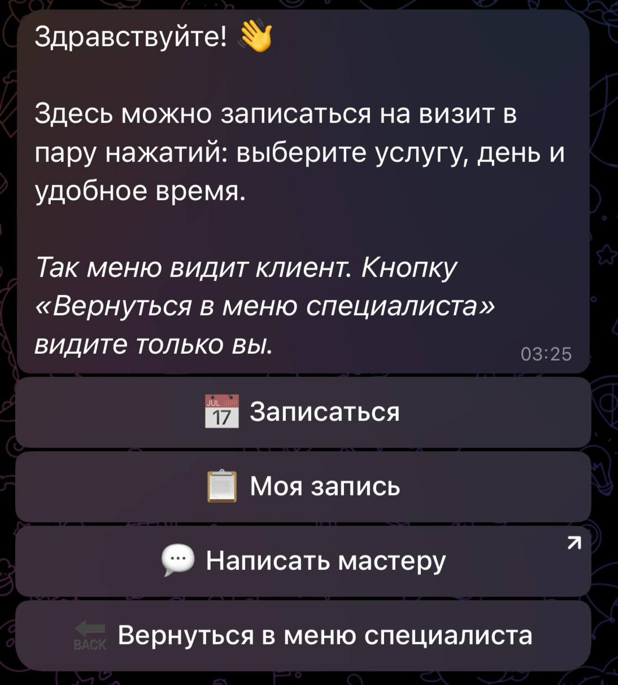</td>
    <td>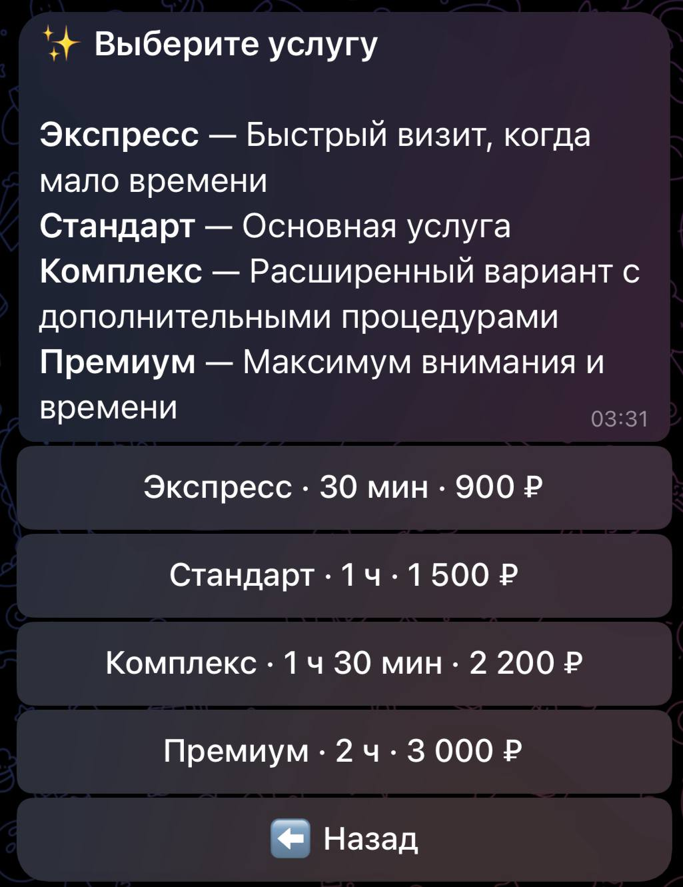</td>
    <td>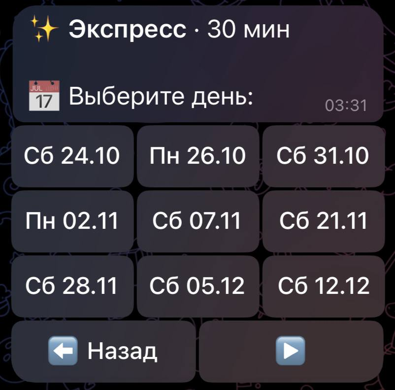</td>
  </tr>
  <tr>
    <td align="center">Главное меню</td>
    <td align="center">Услуги с ценами и длительностью</td>
    <td align="center">Только дни со свободным временем</td>
  </tr>
  <tr>
    <td>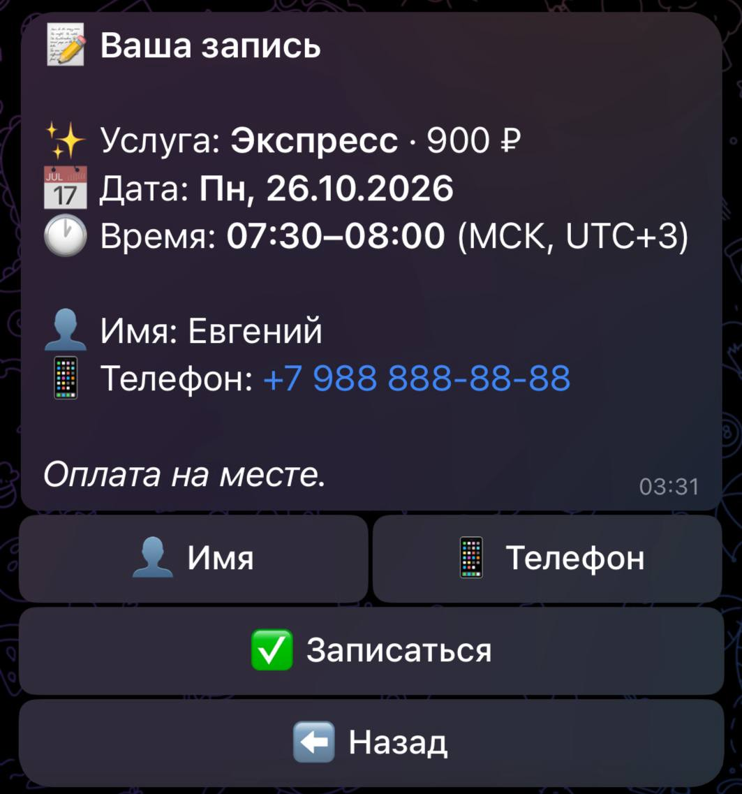</td>
    <td>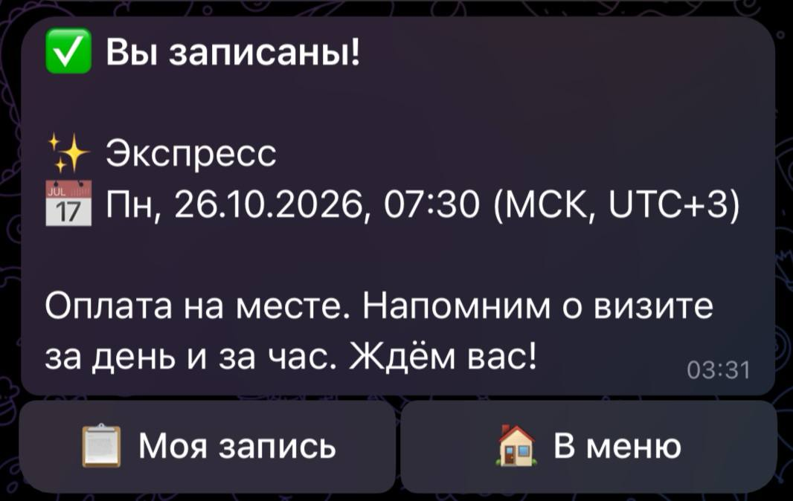</td>
    <td>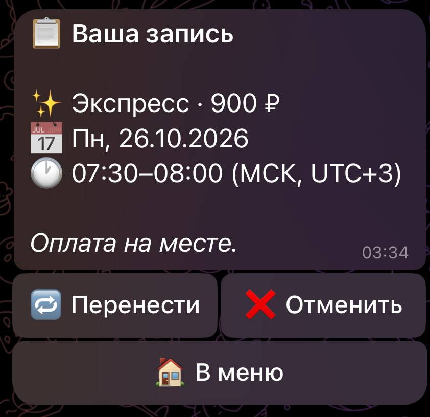</td>
  </tr>
  <tr>
    <td align="center">Карточка: имя и телефон запоминаются</td>
    <td align="center">Запись подтверждена сразу</td>
    <td align="center">Перенос и отмена</td>
  </tr>
</table>

Специалист: уведомления, меню, расписание и записи.

<table>
  <tr>
    <td>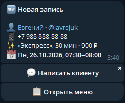</td>
    <td>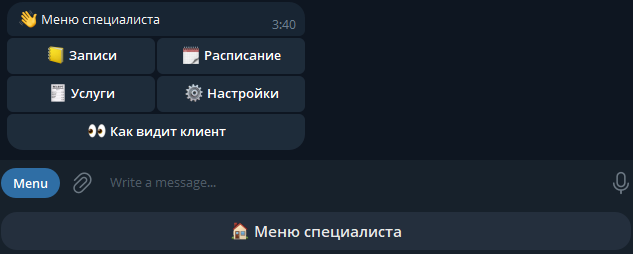</td>
    <td>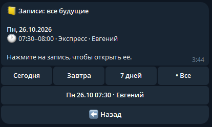</td>
  </tr>
  <tr>
    <td align="center">Уведомление о новой записи</td>
    <td align="center">Меню и постоянная кнопка внизу</td>
    <td align="center">Записи с фильтрами по дням</td>
  </tr>
  <tr>
    <td>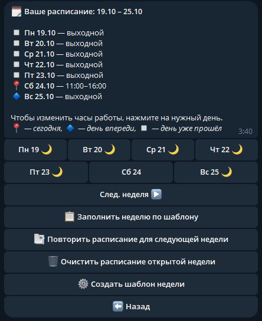</td>
    <td>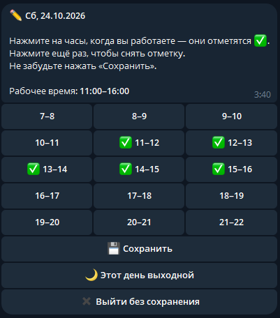</td>
    <td></td>
  </tr>
  <tr>
    <td align="center">Расписание недели и шаблон</td>
    <td align="center">Рабочие часы — нажатием на сетку</td>
    <td></td>
  </tr>
</table>

---

## Возможности

### Для клиента
- **Запись в несколько нажатий:** услуга → день → время → имя и телефон → «Записаться». Весь путь проходит в одном сообщении, которое обновляется на месте, — чат не засоряется.
- **Только свободное время.** Бот сам считает окна под длительность выбранной услуги: часовая и двухчасовая услуги получают разные варианты.
- **Постоянных клиентов узнаёт:** имя и телефон спрашивает один раз. Телефон можно ввести в любом виде (`89001234567`, `+7 (900) 123-45-67`…) или отправить кнопкой «Поделиться контактом».
- **«Моя запись»:** перенос на другое время и отмена.
- **Напоминания** за сутки (с кнопками «Перенести» и «Отменить») и за час до визита.
- **«Написать мастеру»** — кнопка сразу открывает чат со специалистом.

### Для специалиста
- **Уведомления** о новой записи, отмене и переносе: имя, телефон, услуга, время, кнопка «Написать клиенту».
- **Записи:** списки «Сегодня / Завтра / 7 дней / Все», карточка записи, отмена с причиной — клиент получает уведомление.
- **Расписание:** шаблон недели, заполнение недели по шаблону, повтор расписания на следующую неделю, редактор дня с сеткой часов (перерывы — просто неотмеченные часы).
- **Защита записей:** если новое расписание задевает записи клиентов, бот предупредит и предложит оставить эти часы рабочими или отменить записи с уведомлением клиентов.
- **Услуги:** добавление, изменение названия, длительности, цены и описания, скрытие, удаление и порядок в списке. Удаление не ломает уже сделанные записи на эту услугу.
- **Настройки:** текст приветствия для клиентов.
- **Меню всегда под рукой:** постоянная кнопка внизу экрана и кнопка «Открыть меню» под уведомлениями.
- **«Как видит клиент»** — специалист может пройти весь путь записи сам.

---

## Как это устроено

**Расчёт свободного времени** (`logic/slots.py`). Специалист задаёт рабочие интервалы (например, 10:00–14:00 и 15:00–19:00). Бот перебирает время начала с шагом 30 минут и оставляет только те варианты, где визит целиком помещается в рабочее время и не пересекается с другими записями. Это чистая функция без Telegram и базы данных, покрытая тестами.

**Защита от двойной записи** (`db.create_booking`). Запись создаётся в транзакции `BEGIN IMMEDIATE`: пока одна запись проверяется и сохраняется, другие операции записи ждут. Все проверки (время свободно, в рабочих часах, у клиента нет другой записи) повторяются в момент нажатия «Записаться». Тест запускает двух клиентов одновременно на одно время — запись получает ровно один.

**Перенос без риска остаться без записи.** Перенос — одна транзакция: новое время проверяется и занимается, старая запись помечается «перенесена». Если новое время успели занять, старая запись остаётся.

**История не теряется.** Отменённые и перенесённые записи не удаляются, а меняют статус; хранится, кто и почему отменил.

**Напоминания** (`reminders.py`) — фоновая задача, раз в минуту. Отметка «напомнили» ставится в базе до отправки, поэтому после перезапуска бота напоминания не дублируются. Учитываются поздние записи (записался за 3 часа — суточного напоминания не будет) и простой бота.

**Часовой пояс.** Всё расписание живёт по времени специалиста (`TIMEZONE`), клиенту время показывается с подписью «МСК, UTC+3». Смещение считается автоматически.

**Безопасность.** Раздел специалиста закрыт фильтром по Telegram ID на уровне роутера. Данные кнопок можно подделать, но все действия заново проверяются на сервере: чужую запись не отменить и не перенести. Всё, что вводят пользователи, экранируется перед выводом. Токен хранится только в `.env`.

---

## Структура проекта

```
bot.py               точка входа: запуск бота и напоминаний
config.py            настройки из .env, текущее время в поясе специалиста
db.py                схема БД и все SQL-запросы
texts.py             все тексты бота — главный файл для адаптации под заказчика
notifications.py     уведомления специалисту и клиентам
reminders.py         напоминания о визитах
formatting.py        вывод цен, длительности, дат
states.py            шаги диалогов (FSM)
logic/               чистая логика: свободное время, расписание, проверка ввода
keyboards/           кнопки клиента и специалиста
handlers/client/     меню, запись, «Моя запись»
handlers/master/     меню, услуги, расписание, записи, настройки
tests/               автотесты (pytest)
```

---

## Запуск

1. Создайте бота у [@BotFather](https://t.me/BotFather) и получите токен.
2. Установите зависимости:
   ```bash
   python -m venv .venv
   .venv\Scripts\activate          # Windows
   source .venv/bin/activate       # Linux / macOS
   pip install -r requirements.txt
   ```
3. Скопируйте `.env.example` в `.env` и заполните.
4. Запустите:
   ```bash
   python bot.py
   ```
   При первом запуске создаётся база `bot.db` с демо-услугами и шаблоном недели.
   Специалисту остаётся открыть «🗓 Расписание» и заполнить недели по шаблону.

### Настройки `.env`

| Параметр | Что это | Пример |
|---|---|---|
| `BOT_TOKEN` | токен от @BotFather | `1234567890:AA…` |
| `MASTER_TG_ID` | Telegram ID специалиста (узнать у @userinfobot) | `123456789` |
| `MASTER_USERNAME` | username специалиста для кнопки «Написать мастеру» | `anna_master` |
| `TIMEZONE` | часовой пояс специалиста | `Europe/Moscow` |
| `TIMEZONE_LABEL` | его короткое название для клиентов | `МСК` |
| `BOOKING_STEP_MIN` | шаг времени записи, мин | `30` |
| `BOOKING_HORIZON_DAYS` | на сколько дней вперёд можно записаться | `60` |
| `DB_PATH` | файл базы данных | `bot.db` |

---

## Тесты

```bash
pip install -r requirements-dev.txt
pytest
```

76 тестов проверяют расчёт свободного времени, проверку ввода и целые сценарии «от имени пользователя»: запись, гонку двух клиентов, перенос, отмену, защиту записей при изменении расписания, напоминания (с «перемоткой» времени), права доступа. Настоящий Telegram в тестах не нужен — сеть заменена заглушкой.

---

## Адаптация под заказчика

- тексты и названия кнопок — `texts.py`;
- услуги, цены, расписание, приветствие — прямо в боте, в меню специалиста;
- город и шаг записи — `.env`.

## Ограничения и планы

- Один специалист на бота (таблица `masters` заложена под расширение до салона).
- Шаги незаконченных диалогов хранятся в памяти и сбрасываются при перезапуске; сами записи и данные клиентов — в базе.
- Возможные доработки: несколько специалистов, предоплата, экспорт записей, хранение диалогов в Redis.
